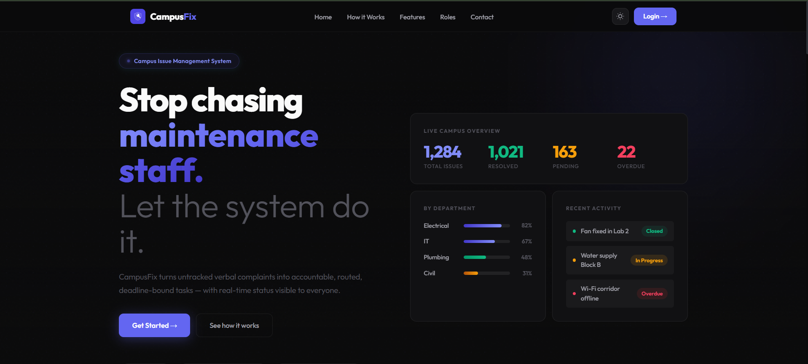
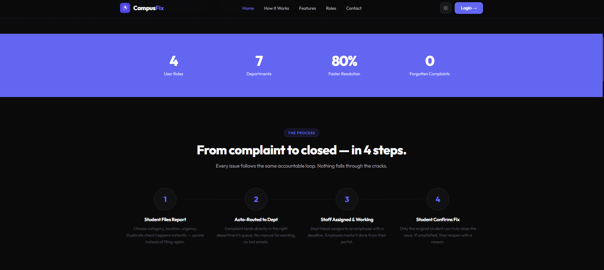
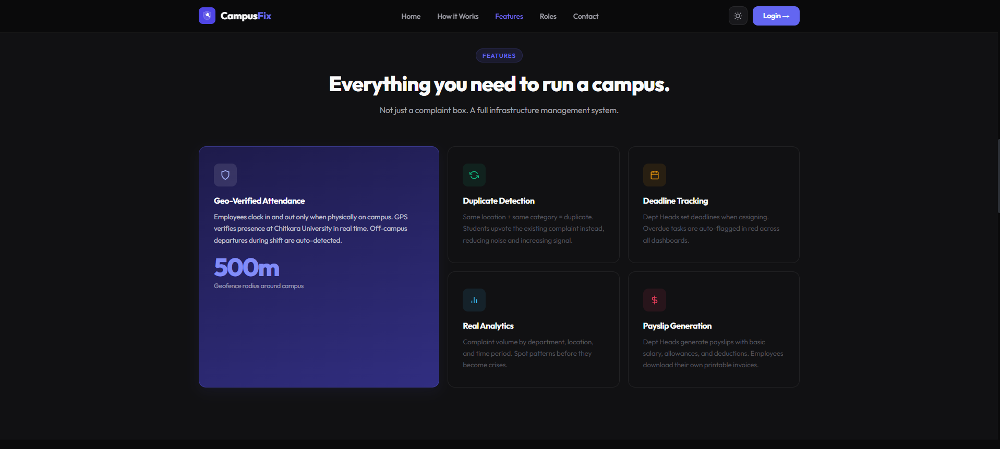
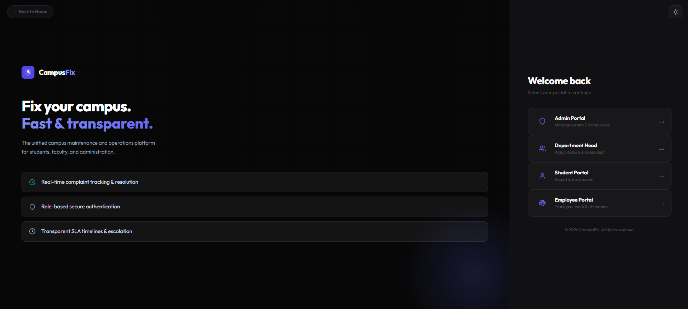
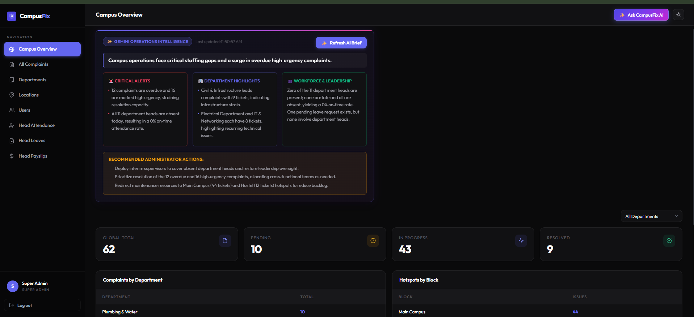
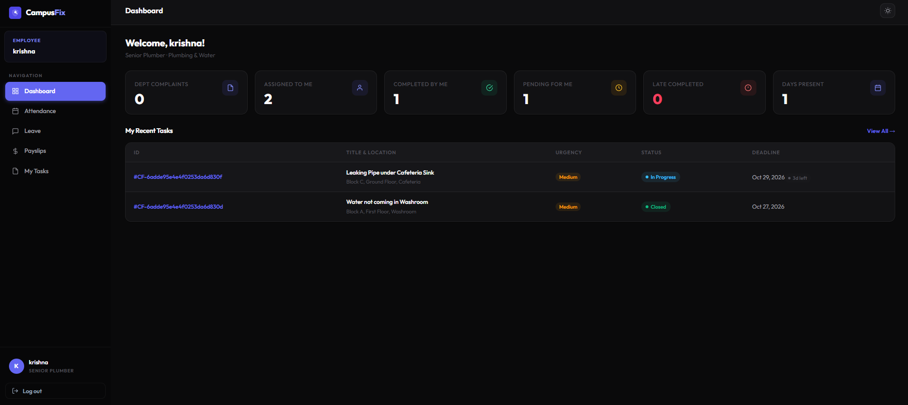
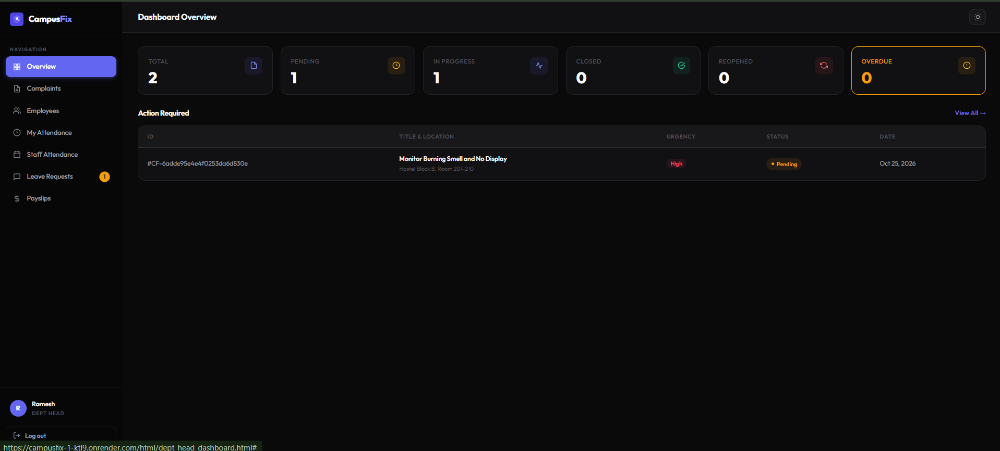
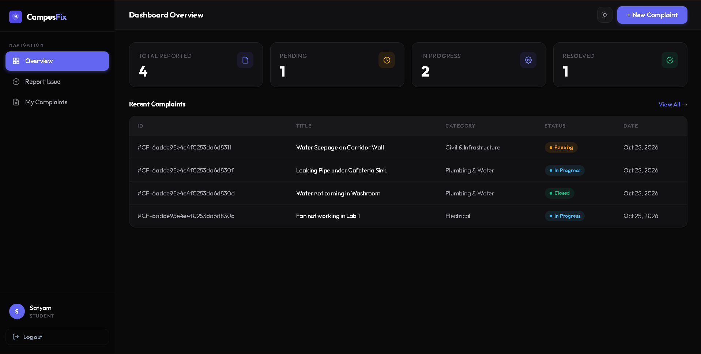
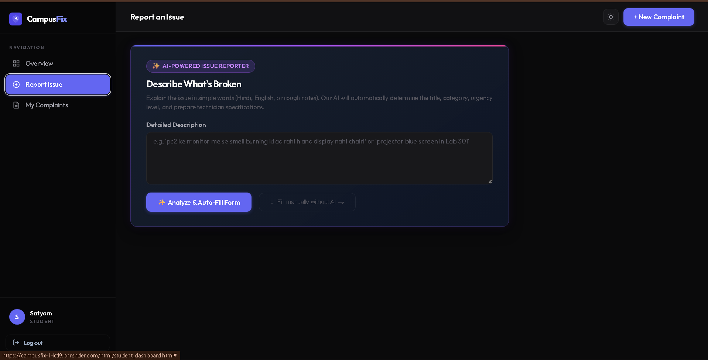

<div align="center">


# CampusFix

### Campus Issue Management System

**Stop chasing maintenance staff. Let the system do it.**

> A centralized, role-based campus infrastructure management platform built for Chitkara University — turning untracked verbal complaints into accountable, routed, deadline-bound tasks with real-time visibility for everyone.

[](https://nodejs.org)
[](https://expressjs.com)
[](https://mongodb.com)
[](LICENSE)

[🌐 Live Demo](https://campusfix-1-kt9.onrender.com) · [📁 GitHub Repo](https://github.com/Satyam2006chh/CampusFix)

</div>

---

## 📋 Table of Contents

- [Problem Statement](#-problem-statement)
- [Screenshots](#-screenshots)
- [What CampusFix Does](#-what-campusfix-does)
- [Key Features](#-key-features)
- [Tech Stack](#-tech-stack)
- [System Flowchart](#-system-flowchart)
- [Portals & Roles](#-portals--roles)
- [Getting Started](#-getting-started)
- [API Endpoints](#-api-endpoints)
- [Team](#-team)

---

## 🚨 Problem Statement

Campus infrastructure management at Chitkara University (and most Indian colleges) is broken. Here's exactly what we identified:

- 📢 **Verbal complaints evaporate** — Students report issues to wardens verbally. With hundreds of students and issues, these complaints are forgotten within 48 hours
- 🔍 **Zero tracking after reporting** — After submitting a complaint, students have no visibility: Was it registered? Who is handling it? When will it be fixed?
- ❓ **No one knows who to contact** — Is it the warden? Faculty? Maintenance? Electrical? The hierarchy is unclear and varies per department
- 📑 **Duplicate complaints flood the system** — 10 students find the same broken cooler and file 10 separate complaints. No deduplication exists
- ⏰ **Zero accountability on deadlines** — Complaints stay open indefinitely. No SLA, no escalation, no pressure on staff
- 📊 **No centralized data for authorities** — Nobody can see how many issues exist, which department has the most complaints, or which are overdue
- 🏢 **Problems are everywhere with no single place to report** — Classrooms, labs, washrooms, corridors, IT infrastructure, hostel — each needs a different process
- 💰 **No employee management** — No system for tracking employee attendance, leaves, or salary disbursement
- 🤖 **No intelligence** — Admin has no AI-powered briefings or anomaly detection to make faster decisions

---

## 📸 Screenshots

<div align="center">

### 🏠 Homepage


### 📊 How It Works — 4 Step Process


### ✨ Features Section


### 🎭 Role Cards


### 👨‍🎓 Student Dashboard


### 🏢 Department Head Dashboard


### 👷 Employee Dashboard


### 🛡️ Admin Dashboard


### 🔐 OTP Verified Registration


</div>

---

## 💡 What CampusFix Does

CampusFix is a **full-stack campus infrastructure management system** that replaces the chaos of verbal complaints with a structured, accountable, data-driven workflow.

### Problems it solves:

- ✅ **Structured Reporting** — Students file complaints with category, location (Campus → Block → Floor → Room), urgency, and description
- ✅ **Auto-Routing** — Complaint automatically reaches the correct department based on category — no manual forwarding
- ✅ **Real-Time Tracking** — Students see exactly who is assigned to their issue and the current status at all times
- ✅ **Smart Duplicate Detection** — Same location + same category = duplicate. Students upvote instead of filing again
- ✅ **Deadline Enforcement** — Dept Heads set deadlines. Overdue tasks are auto-flagged in red across all dashboards
- ✅ **Student Confirmation Loop** — Only the original student can truly close a complaint. If unsatisfied, they reopen with a reason
- ✅ **GPS-Verified Attendance** — Employees must be within 500m of Chitkara University campus to clock in/out. Off-campus departures during shift are auto-detected
- ✅ **AI-Powered Admin Briefings** — Admin gets a 30-second AI executive summary using Groq AI with live MongoDB data
- ✅ **Leave & Payslip Management** — Complete HR workflow for employees under each department
- ✅ **OTP-Based Registration** — Only `@chitkara.edu.in` email holders can register as students

---

## ✨ Key Features

| Feature | Description |
|---------|-------------|
| 🔐 **OTP Registration** | Only verified `@chitkara.edu.in` emails can register |
| 📍 **Geo-Verified Attendance** | 500m geofence around Chitkara University, Rajpura |
| 🕐 **Smart Clock-In Categories** | On Time (before 9:00) · Slightly Late (9:00–9:30) · Late (after 9:30) |
| 🚨 **Early Departure Detection** | Background location checks every 30 min during shift |
| 🔁 **Duplicate Detection** | Same location + category → upvote instead of re-filing |
| 📅 **Deadline Tracking** | Auto-flagged overdue complaints across all dashboards |
| 🤖 **AI Campus Briefing** | Groq AI generates live executive summaries for admin |
| 💳 **Payslip Generation** | Dept Heads generate printable PDF payslips for employees |
| 🌿 **Leave Management** | Employees apply → Dept Head approves/rejects with real-time status |
| 📊 **Real Analytics** | Complaint trends by department, location, and time |
| 🌙 **Dark/Light Theme** | System-wide theme toggle with localStorage persistence |

---

## 🛠 Tech Stack

### Backend
| Technology | Purpose |
|-----------|---------|
| **Node.js 18+** | Runtime environment |
| **Express.js 4.x** | REST API framework |
| **MongoDB Atlas** | Cloud database (Mongoose ODM) |
| **JWT** | Authentication & authorization |
| **bcryptjs** | Password hashing |
| **SendGrid** | OTP email delivery (HTTPS API) |
| **Groq AI** | AI-powered admin briefings |

### Frontend
| Technology | Purpose |
|-----------|---------|
| **HTML5 / CSS3** | Structure & styling |
| **Vanilla JavaScript** | Business logic, no framework |
| **Outfit Font** | Typography (Google Fonts) |
| **CSS Custom Properties** | Theme system (dark/light) |

### Infrastructure
| Service | Purpose |
|---------|---------|
| **Render** | Backend hosting |
| **MongoDB Atlas** | Database hosting |
| **GitHub** | Version control & CI/CD |

---

## 🔄 System Flowchart

```
┌─────────────────────────────────────────────────────────────────────┐
│                        CAMPUSFIX WORKFLOW                           │
└─────────────────────────────────────────────────────────────────────┘

  STUDENT                 SYSTEM                  DEPT HEAD          EMPLOYEE
    │                       │                         │                  │
    │  Register with         │                         │                  │
    │  @chitkara.edu.in  ───►│  OTP Verification       │                  │
    │  OTP verified          │  (SendGrid Email)        │                  │
    │                        │                         │                  │
    │  File Complaint    ───►│  Auto-route to           │                  │
    │  (category +           │  correct department      │                  │
    │   location +           │  based on category       │                  │
    │   urgency)             │                         │                  │
    │                        │                         │                  │
    │                        │  Duplicate check?        │                  │
    │                        │  ↓ Yes → Upvote          │                  │
    │                        │  ↓ No  → Create          │                  │
    │                        │                         │                  │
    │                        │  Complaint appears  ───►│  Sees in          │
    │                        │  in dept queue           │  dept queue       │
    │                        │                         │                  │
    │                        │                         │  Assigns to  ───►│  Sees task
    │                        │                         │  employee +      │  in portal
    │                        │                         │  sets deadline   │
    │                        │                         │                  │
    │                        │                         │                  │  Clocks In
    │                        │                         │                  │  (GPS verify)
    │                        │                         │                  │
    │                        │                         │                  │  Marks
    │                        │                         │                  │  Resolved ──►
    │                        │                         │                  │
    │  Gets "Waiting     ◄───│  Status update           │                  │
    │  Confirmation"         │                         │                  │
    │                        │                         │                  │
    │  Confirms YES  ───────►│  Status = CLOSED         │                  │
    │  OR                    │                         │                  │
    │  Reopens with  ───────►│  Status = REOPENED       │                  │
    │  reason                │  → back to dept head     │                  │

                    ┌────────────────────┐
                    │   ADMIN OVERSIGHT  │
                    │                    │
                    │  • All complaints  │
                    │  • All departments │
                    │  • All users       │
                    │  • Analytics       │
                    │  • AI Briefings    │
                    │  • Head Attendance │
                    │  • Head Payslips   │
                    └────────────────────┘
```

---

## 🎭 Portals & Roles

### 👨‍🎓 Student Portal
- Register with `@chitkara.edu.in` email (OTP verified)
- File structured complaints with location picker
- Track real-time complaint status
- See which employee is assigned
- Upvote duplicate complaints
- Confirm or reopen resolved issues

### 👷 Employee Portal
- View all assigned tasks
- GPS-verified clock in/out (must be within 500m of campus)
- Time categories: On Time / Slightly Late / Late
- Apply for leave (routed to dept head)
- View generated payslips & download

### 🏢 Department Head Portal
- See all complaints for their department
- Assign complaints to employees with deadlines
- Manage employee roster
- View employee attendance logs with date filters
- Approve/reject employee leaves
- Generate payslips for employees
- GPS self-attendance

### 🛡️ Admin Portal
- Full campus analytics dashboard
- Manage all 7 departments
- Create/deactivate dept heads & users
- View all complaints with dept/status filters
- Department Head attendance analytics with AI anomaly detection
- Department Head leave management
- Department Head payslip management
- AI-powered daily executive briefing (Groq AI)

---

## 🚀 Getting Started

### Prerequisites
- Node.js 18+
- npm

### Installation

```bash
# Clone the repo
git clone https://github.com/Satyam2006chh/CampusFix.git
cd CampusFix/CE-2/backend

# Install dependencies
npm install

# Setup environment
cp .env.example .env
# Fill in your values (MongoDB URI, SendGrid key, etc.)

# Start development server
npm run dev
```

Open `CE-2/frontend/html/login.html` in your browser.

### Default Credentials

| Role | Email | Password |
|------|-------|----------|
| Admin | admin@campusfix.com | admin@123 |
| Dept Head (Electrical) | ramesh@gmail.com | password123 |
| Dept Head (Plumbing) | suresh@gmail.com | password123 |
| Student | satyam@gmail.com | Satyam@123 |
| Employee (Plumbing) | krishna@gmail.com | Krishna@123 |

---

## 📡 API Endpoints

```
POST   /api/auth/login                    Login (all roles)
POST   /api/auth/send-registration-otp   Send OTP to chitkara email
POST   /api/auth/verify-and-register     Verify OTP & create account
POST   /api/auth/forgot-password         Send password reset OTP
POST   /api/auth/reset-password          Reset password

GET    /api/complaints                    Get complaints (with filters)
POST   /api/complaints                    Create complaint
PATCH  /api/complaints/:id               Update complaint status
DELETE /api/complaints/:id               Delete complaint

GET    /api/users                         Get users (role filter)
POST   /api/users                         Create user
PATCH  /api/users/:id                    Update user

GET    /api/departments                   Get departments
GET    /api/locations                     Get locations

GET    /api/attendance                    Get attendance records
POST   /api/attendance                    Clock in
PATCH  /api/attendance/:id               Clock out

GET    /api/leaves                        Get leave requests
POST   /api/leaves                        Apply for leave
PATCH  /api/leaves/:id                   Approve/reject leave

GET    /api/payslips                      Get payslips
POST   /api/payslips                      Generate payslip
```

---

## 👥 Team

Built at **Department of Computer Science, Chitkara University, Rajpura**

| Name | Role |
|------|------|
| **Satyam Chhabra** | Full Stack — Employee Portal, Homepage, Theme, Backend Architecture |
| **Raman Bansal** | Admin Portal, AI Features, MongoDB Migration, Deployment |
| **Saksham** | Student Portal, OTP Registration, Forgot Password |

---

<div align="center">

**CampusFix** — *Centralized. Transparent. Accountable.*

⭐ Star this repo if it helped you!

</div>
