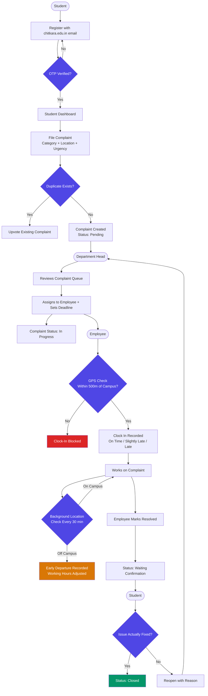

<div align="center">

<svg width="80" height="80" viewBox="0 0 40 40" fill="none" xmlns="http://www.w3.org/2000/svg">
  <rect width="40" height="40" rx="10" fill="#4f46e5"/>
  <path d="M20 9L11 13V19C11 24.2 15 29.1 20 30.3C25 29.1 29 24.2 29 19V13L20 9Z" fill="white" fill-opacity="0.12" stroke="white" stroke-width="1" stroke-opacity="0.3"/>
  <path d="M23.5 14.5C22.1 13.1 20.1 12.7 18.3 13.5L20.8 16L19.5 17.3L17 14.8C16.2 16.6 16.6 18.6 18 20C19.2 21.2 20.9 21.6 22.5 21.1L25.5 24.1C25.9 24.5 26.5 24.5 26.9 24.1C27.3 23.7 27.3 23.1 26.9 22.7L23.9 19.7C24.4 18.1 24 16.4 23.5 14.5Z" fill="white"/>
</svg>

# CampusFix

### Campus Issue Management System

**A centralized, role-based campus infrastructure management platform built for Chitkara University**

[](https://nodejs.org)
[](https://expressjs.com)
[](https://mongodb.com)
[](https://developer.mozilla.org/en-US/docs/Web/JavaScript)
[](https://render.com)

**[Live Backend](https://campusfix-q2ix.onrender.com)**&nbsp;&nbsp;|&nbsp;&nbsp;**[GitHub Repository](https://github.com/Satyam2006chh/CampusFix)**

</div>

---

## Problem Statement

Campus infrastructure management at most Indian colleges — including Chitkara University — operates on an informal, unstructured system that consistently fails students, staff, and administration alike.

**Core problems we identified and solved:**

- Students report infrastructure problems verbally to wardens and faculty. With hundreds of active issues at any point, these complaints are either forgotten, misrouted, or simply never addressed
- After reporting an issue, students have zero visibility into its status. There is no record of whether the complaint was even registered, who is handling it, or when it will be resolved
- The responsibility chain is unclear. Students do not know whether to approach the warden, the faculty, the electrical department, the IT team, or maintenance — each issue requires figuring out a different contact
- When multiple students encounter the same issue, each files a separate complaint. Without duplicate detection, the same problem generates tens of redundant tickets
- There are no deadlines, no SLAs, and no escalation paths. A complaint can remain open for weeks with no consequences for any party
- Administration has no centralized view of how many issues exist, which departments are underperforming, which locations are hotspots, or what the resolution trends look like
- There is no formal employee management system. Attendance is not tracked, leaves have no approval workflow, and salary disbursement has no digital record
- Fake attendance fraud is possible. Without location verification, an employee can mark themselves present from home

---

## Screenshots

### Homepage


### How It Works


### Features Section


### Student Dashboard


### Department Head Dashboard


### Employee Dashboard


### Admin Dashboard


### OTP Verified Registration


---

## What CampusFix Does

CampusFix replaces the entire informal complaint-handling process with a structured, accountable, and data-driven workflow. Every complaint is tracked from the moment it is filed to the moment the student confirms it is resolved.

**Complaint lifecycle:**
- A student files a structured complaint with category, exact location (Campus → Block → Floor → Room), urgency level, and description
- The system automatically detects if a duplicate complaint exists for the same location and category. If yes, the student upvotes the existing issue instead of creating a new one
- The complaint is automatically routed to the correct department based on the selected category — no manual forwarding, no lost emails
- The department head assigns the complaint to a specific employee and sets a resolution deadline
- The employee works on the issue and marks it resolved from their portal
- The student receives a notification and either confirms the fix is complete (complaint closes) or reopens it with a reason (complaint returns to the department)
- If a deadline is missed, the complaint is automatically flagged as overdue across all dashboards

**Employee management:**
- Employees clock in and out only when physically present within 500 metres of Chitkara University campus, verified by GPS coordinates
- The system records three attendance categories based on clock-in time: On Time (before 9:00 AM), Slightly Late (9:00–9:30 AM), and Late (after 9:30 AM)
- A background check runs every 30 minutes during a shift. If the employee is found outside the geofence, an early departure is recorded and their working hours are adjusted accordingly
- Employees can apply for leave through their portal. The request is routed directly to their department head for approval or rejection
- Department heads generate monthly payslips with basic salary, allowances, and deductions. Employees can view and download their payslips at any time

**Administration:**
- The admin has a full campus-wide view of all complaints, all departments, all users, and all attendance data
- An AI-powered briefing powered by Groq generates a 30-second executive summary of campus operations using live MongoDB data
- The admin manages department heads — creating accounts, viewing attendance, approving leaves, and issuing payslips

---

## Key Features

| Feature | Description |
|---------|-------------|
| OTP-based Registration | Only `@chitkara.edu.in` emails allowed. OTP sent via Twilio SMS to student phone number |
| Geo-Verified Attendance | Employees must be within 500m of Chitkara University, Rajpura (30.5094° N, 76.6566° E) to clock in or out |
| Shift Monitoring | Background GPS checks every 30 minutes detect early departures and adjust working hours |
| Duplicate Detection | Same location + same category triggers an upvote prompt instead of creating a duplicate ticket |
| Auto-Routing | Complaints are automatically directed to the correct department based on category |
| Deadline Tracking | Department heads set deadlines on assignment. Overdue complaints are auto-flagged in red |
| Student Confirmation | Only the reporting student can close a complaint. Unsatisfied students can reopen with a reason |
| Leave Management | Employees apply for leave through the portal. Department heads approve or reject with real-time status update |
| Payslip Generation | Department heads generate monthly payslips. Employees download printable PDF invoices |
| AI Admin Briefing | Groq AI generates a live executive summary of campus operations for the administrator |
| Real Analytics | Complaint volume trends by department, location, and time period |
| Role-Based Access | Four completely separate portals — Admin, Department Head, Employee, Student |

---

## Tech Stack

### Backend

| Technology | Version | Purpose |
|-----------|---------|---------|
| Node.js | 18+ | Runtime environment |
| Express.js | 4.18 | REST API framework |
| MongoDB Atlas | — | Cloud database |
| Mongoose | 8.x | ODM for MongoDB |
| JSON Web Token | 9.x | Authentication |
| bcryptjs | 2.x | Password hashing |
| Twilio Verify | REST API | OTP SMS delivery (works on Render) |
| Groq AI | REST API | AI-powered admin briefings |
| Twilio | REST API | SMS verification service |

### Frontend

| Technology | Purpose |
|-----------|---------|
| HTML5 | Structure |
| CSS3 with Custom Properties | Styling and theming |
| Vanilla JavaScript (ES6+) | Business logic |
| Outfit (Google Fonts) | Typography |

### Infrastructure

| Service | Purpose |
|---------|---------|
| Render | Backend hosting |
| MongoDB Atlas | Database hosting |
| GitHub | Version control |
| Twilio | SMS OTP delivery |

---

## System Flowchart



---

## Portals and Roles

### Student Portal

The student portal is the primary interface for reporting and tracking campus infrastructure issues.

**Capabilities:**
- Register using a `@chitkara.edu.in` email address, verified via OTP sent via Twilio SMS to their phone number
- File structured complaints by selecting category (Electrical, Plumbing, IT, Civil, Cleaning, Security, Hostel), location from a hierarchical picker (Campus → Block → Floor → Room), urgency level (Low, Medium, High), and a detailed description
- When filing a complaint, the system checks for an existing open complaint with the same category and location. If one exists, the student is prompted to upvote instead of filing a duplicate
- Track complaint status in real time: Pending, In Progress, Waiting Confirmation, Closed, Reopened, or Overdue
- See the name of the employee assigned to their issue
- When a complaint is marked resolved by the department, receive a confirmation prompt. Confirming closes the complaint permanently. Declining reopens it with a required reason that is sent back to the department head
- View complaint history with all status transitions

---

### Employee Portal

The employee portal manages daily work tasks, attendance, leave, and payslips for field staff.

**Capabilities:**
- View all complaints assigned by the department head, with urgency level, location, deadline, and current status
- Mark assigned complaints as resolved, which triggers a confirmation request to the original student
- Clock in at the start of the workday. The system requests GPS coordinates and verifies the employee is within 500 metres of Chitkara University campus. Clock-in is blocked if the location check fails
- Clock out at the end of the workday with the same GPS verification. Working hours are automatically calculated
- The system performs a background location check every 30 minutes during an active shift. If the employee is detected outside the campus boundary, the departure time is recorded and effective working hours are recalculated at clock-out
- Time at clock-in is categorized as On Time (before 9:00 AM), Slightly Late (9:00–9:30 AM), or Late (after 9:30 AM)
- View attendance history including clock-in time, clock-out time, total hours worked, punctuality status, and early departure flags
- Apply for leave by selecting leave type (Sick, Casual, Annual, Emergency), specifying dates, and providing a reason. The request is automatically routed to the department head
- View all leave requests with current approval status
- View monthly payslips generated by the department head, showing basic salary, allowances, deductions, and net salary
- Download any payslip as a printable PDF

---

### Department Head Portal

The department head portal provides complete management over a single department's complaints, staff, attendance, leaves, and payroll.

**Capabilities:**
- View all active complaints routed to the department, filterable by status and date
- Assign complaints to available employees, set a resolution deadline, and update assignment status
- When an employee marks a complaint resolved, the department head sees the status update to Waiting Confirmation
- If a student reopens a complaint, it returns to the department head queue
- Add new employees to the department by creating accounts with name, email, designation, and temporary password
- Edit or remove existing employees
- View the full attendance log of all employees in the department, filterable by employee name and date. Records include clock-in time, clock-out time, hours worked, punctuality category, and geofence audit status
- Record own daily attendance with GPS verification, subject to the same geofence rules as employees
- Review leave applications from employees and approve or reject them with one click. Status is updated in real time on the employee's portal
- Generate monthly payslips for employees by entering basic salary, allowances, and deductions. The system calculates net salary automatically
- View all generated payslips and download any as a printable PDF

---

### Admin Portal

The admin portal provides full oversight and control over the entire campus infrastructure system.

**Capabilities:**
- View campus-wide complaint analytics including total count, pending, in progress, resolved, reopened, and overdue, broken down by department and location block
- Generate an AI-powered daily briefing using Groq AI that synthesizes live MongoDB data into a 30-second executive summary covering complaint trends, department resolution velocity, infrastructure hotspots, and attendance compliance
- Manage all seven departments: Civil and Infrastructure, Cleaning and Sanitation, Electrical, Hostel Maintenance, IT and Networking, Plumbing and Water, Security and Safety
- Assign department heads to departments, edit their details, or deactivate their accounts
- Manage campus locations using a structured hierarchy (Campus → Block → Floor → Room)
- View and manage all user accounts across all roles
- View the attendance log of all department heads with date and status filters, and run an AI anomaly detection audit to flag geofence violations or irregular patterns
- Review and approve or reject leave applications from department heads
- Issue and manage monthly payslips for department heads

---

## Getting Started

### Prerequisites

- Node.js 18 or higher
- npm

### Installation

```bash
git clone https://github.com/Satyam2006chh/CampusFix.git
cd CampusFix/CE-2/backend
npm install
cp .env.example .env
```

Edit `.env` and fill in:
- `MONGO_URI` — your MongoDB Atlas connection string
- `TWILIO_ACCOUNT_SID — from twilio.com
- `TWILIO_AUTH_TOKEN — from twilio.com
- `JWT_SECRET` — any long random string
- `GROQ_API_KEY` — from console.groq.com (optional, for AI briefings)

```bash
npm run dev
```

Then open `CE-2/frontend/html/login.html` in your browser.

### Default Login Credentials

| Role | Email | Password |
|------|-------|----------|
| Admin | admin@campusfix.com | admin@123 |
| Dept Head — Electrical | ramesh@gmail.com | password123 |
| Dept Head — Plumbing | suresh@gmail.com | password123 |
| Student | satyam@gmail.com | Satyam@123 |
| Employee — Plumbing | krishna@gmail.com | Krishna@123 |

---

## API Reference

```
POST   /api/auth/login                     Authenticate any user role
POST   /api/auth/send-registration-otp     Send OTP to chitkara.edu.in email
POST   /api/auth/verify-and-register       Verify OTP and create student account
POST   /api/auth/forgot-password           Send password reset OTP
POST   /api/auth/reset-password            Set new password after OTP verification

GET    /api/complaints                      List complaints with optional filters
POST   /api/complaints                      Create a new complaint
PATCH  /api/complaints/:id                 Update complaint (status, assignment, etc.)
DELETE /api/complaints/:id                 Delete complaint (admin only)

GET    /api/departments                     List all departments
POST   /api/departments                     Create department (admin only)
PATCH  /api/departments/:id                Update department

GET    /api/locations                       List all campus locations
POST   /api/locations                       Add location (admin only)

GET    /api/users                           List users with role filter
POST   /api/users                           Create user
PATCH  /api/users/:id                      Update user details or status

GET    /api/attendance                      Get attendance records with filters
POST   /api/attendance                      Record clock-in
PATCH  /api/attendance/:id                 Update with clock-out and hours

GET    /api/leaves                          Get leave requests with filters
POST   /api/leaves                          Submit leave application
PATCH  /api/leaves/:id                     Approve or reject leave

GET    /api/payslips                        Get payslips with filters
POST   /api/payslips                        Generate payslip (dept head or admin)
```

---

## Team

Built at the Department of Computer Science, Chitkara University, Rajpura — 2026

| Name | Contribution |
|------|-------------|
| Satyam Chhabra | Employee Portal, Homepage Design, UI Theme, Backend Architecture, OTP Integration |
| Raman Bansal | Admin Portal, AI Features, MongoDB Migration, Render Deployment |
| Saksham | Student Portal, OTP Registration Flow, Forgot Password |

---

<div align="center">

**CampusFix** — Centralized. Transparent. Accountable.

</div>

